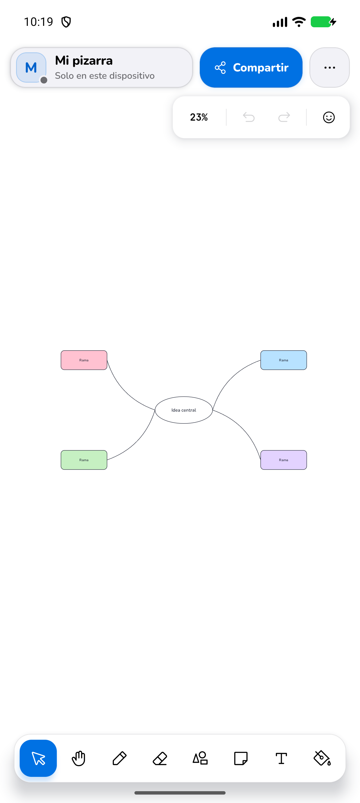
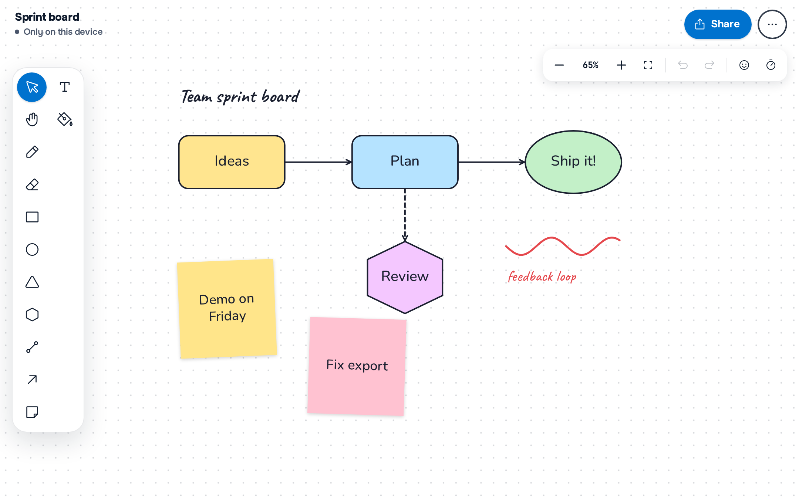

# Shareboard — Server

Fastify + TypeScript backend of [Shareboard](https://github.com/Juan17la/shareboard_web),
the collaborative whiteboard: REST for everything that is not realtime, and a
plain WebSocket for live board sync. Standalone project — the
[web](https://github.com/Juan17la/shareboard_web) and
[Android](https://github.com/Juan17la/shareboard_mobile) clients only depend
on the wire contract.

Full documentation, including the protocol and the internals of this server:
[Shareboard docs](https://github.com/Juan17la/shareboard_mobile/blob/main/docs/README.md)
([communication](https://github.com/Juan17la/shareboard_mobile/blob/main/docs/architecture/communication.md),
[server internals](https://github.com/Juan17la/shareboard_mobile/blob/main/docs/architecture/server.md)).

<div align="center">


&nbsp;&nbsp;


</div>

## Run

```bash
cp .env.example .env         # optional; the defaults work
npm install
npm run dev                  # http://localhost:3000
```

`MONGO_URL` is required: without it the server exits with a message instead of
silently keeping boards in memory, where a restart would lose them. A local
`mongod` (`mongodb://127.0.0.1:27017`) or a free Atlas cluster both work.
`MEMORY_ONLY=true` is the explicit opt-out for throwaway runs.

Boards are served from memory and written behind to MongoDB: a new board is
saved before `POST /boards` answers, and every change is saved within
`WRITE_DELAY_MS` (1 s), so a crash or redeploy loses at most that window. A
board stays in memory while anyone is on it and for 5 minutes after the last
change, and it only leaves memory once it is stored; after that it is loaded
back from MongoDB on the next visit.

## Deploy (Render)

`render.yaml` is a Blueprint: Dashboard → New → Blueprint → this repo, then
fill `MONGO_URL`, `CORS_ORIGIN`, `AI_API_KEY`, `SMTP_USER` and `SMTP_PASS` (see
"Email" below; Render's free plan blocks SMTP, so emails only go out on a paid
instance). On MongoDB Atlas, add Render
under **Network Access** (`0.0.0.0/0`, or the service's outbound IPs) — without
it the connection fails with `tlsv1 alert internal error` (SSL alert 80) and
the server exits. `GET /health` answers 503 until the database does, so a
deploy only takes traffic once it can save boards.

One instance holds each board in memory, so run a single instance (plenty for
~100 users). To scale out with Redis, three per-process pieces change, each
marked `ponytail:` in the code: `ws/hub.ts` broadcasts over a Redis channel per
board, `rate-limit.ts` counts with `INCR`/`PEXPIRE`, and the load balancer
routes each board id to one instance (sticky) so `store/boards.ts` keeps a
single live copy. MongoDB stays the source of truth.

## Email (Gmail)

Email verification is off unless `REQUIRE_EMAIL_VERIFICATION=true`: accounts
share as soon as they are created, and only password-reset codes are emailed.
Verification and password-reset codes are sent over SMTP, from your own Gmail
account by default — no domain needed:

1. Turn on 2-Step Verification on the Google account.
2. Google Account → Security → 2-Step Verification → **App passwords**: create
   one (name it "Shareboard"). Google shows 16 letters once.
3. In `.env` (or the host's environment):

   ```bash
   SMTP_USER=you@gmail.com
   SMTP_PASS=abcdabcdabcdabcd   # the App Password, without spaces — never the account password
   # Optional: MAIL_FROM (defaults to SMTP_USER), MAIL_FROM_NAME (Shareboard),
   # SMTP_HOST (smtp.gmail.com), SMTP_PORT (465; 587 uses STARTTLS)
   ```

On start the server signs in to SMTP and logs `Email: sending as …`, or the
error if the App Password is wrong. Without `SMTP_USER`/`SMTP_PASS` emails are
printed to the log (codes included) in development, and dropped with an error
in production. Gmail allows about 500 emails a day from a personal account.
Any SMTP server works the same way through `SMTP_HOST`/`SMTP_PORT`, e.g.
Amazon SES (`email-smtp.<region>.amazonaws.com`, port 587, its SMTP
credentials), if the app outgrows Gmail.

## Deploy (AWS EC2)

EC2 lets SMTP out on 465 and 587 (only port 25 is throttled), so Gmail works
there as is:

1. Security group: inbound 22 (your IP) and the server port (or 80/443 behind
   a reverse proxy); outbound is open by default.
2. Install Node 22 and MongoDB (or point `MONGO_URL` at Atlas), copy the repo,
   then `npm ci --include=dev && npm run build`.
3. Environment (a systemd `EnvironmentFile`, or `.env` next to `package.json`):
   `NODE_ENV=production`, `TOKEN_SECRET` (`openssl rand -hex 32`; the server
   refuses the default in production), `MONGO_URL`, `CORS_ORIGIN`, `SMTP_USER`,
   `SMTP_PASS`, and `TRUST_PROXY=1` only if a reverse proxy or load balancer
   sits in front (leave it unset when clients reach Node directly, or anyone
   could fake their address with `X-Forwarded-For`).
4. `npm start`, and check the log for `Email: sending as …`.

## REST

| Action | Route | Auth |
|---|---|---|
| Health | `GET /health` | — |
| Create board | `POST /boards` | `X-User-Id` |
| Get board | `GET /boards/:id` | — |
| Resolve short code | `GET /boards/code/:code` | — |
| Join | `POST /boards/:id/join` | — |
| Rename | `PATCH /boards/:id` | creator token |
| Permissions | `PATCH /boards/:id/permissions` | creator token |
| Snapshot | `GET /boards/:id/snapshot` | board token |
| Delete | `DELETE /boards/:id` | creator token |
| Draw with AI | `POST /boards/:id/ai` | board token |
| Draw with AI (offline board) | `POST /ai` | `X-User-Id` |
| Import | `POST /boards/import` | `X-User-Id` |

Errors always use `{ "error": { "code": "...", "message": "..." } }` with the
codes listed in the
[communication docs](https://github.com/Juan17la/shareboard_mobile/blob/main/docs/architecture/communication.md#errors).

`POST /boards/:id/join` validates the PIN, assigns the role and returns a
short-lived `boardToken` (HMAC-signed). The token goes on the WebSocket as
`?token=` and as `Authorization: Bearer` on owner-only routes.

## WebSocket

`ws://localhost:3000/ws?boardId=<id>&token=<boardToken>`

Client sends `join | op | cursor | select | leave | ping`; the server replies
with `joined | op | participants | cursor | permissions | resync | error | pong`. Every
broadcast `op` carries the board's monotonic `seq`. A viewer's op is rejected
with `error FORBIDDEN` and never applied. One user may have several sockets on
a board (two tabs, a laptop and a phone), each sent everything; only a second
socket from the same tab (`tab` in `join`) closes the first one with code
`4001`. A broadcast `op` carries the sender's `tab`, so a tab knows its own echo.

## Layout

```
src/
  model/    types, permission rules, ops, validation, short codes, protocol
  store/    active boards in memory + optional MongoDB persistence
  routes/   REST endpoints and request auth helpers
  ws/       socket handler and the per-board client registry
  app.ts    Fastify wiring and the error envelope
  index.ts  startup, timers, graceful shutdown
```

## Persistence

Active boards live in memory and are written behind to MongoDB within
`WRITE_DELAY_MS` of each change. Boards with nobody on them are evicted after
5 minutes idle (once saved), and everything still dirty is flushed on
SIGTERM/SIGINT.

## License

[MIT License](LICENSE).
